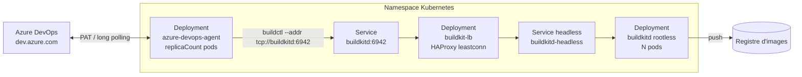

<div align="center">

# Agent Azure DevOps Septeo sur Kubernetes

**Chart Helm et image des agents Azure DevOps auto-hébergés de Septeo**

Maintenu par l'équipe **Intégration & Innovation** de [Septeo](https://www.septeo.com)


</div>

---

Ce chart déploie sur Kubernetes un pool d'agents Azure DevOps auto-hébergés, accompagnés de démons **BuildKit rootless** et d'un **routeur TCP HAProxy** (`balance leastconn`) pour répartir les builds entre les démons selon le nombre de connexions actives — sans Docker-in-Docker ni socket Docker du nœud.

Les agents s'enregistrent automatiquement dans le pool Azure DevOps au démarrage et se désenregistrent à l'arrêt : jouer sur `replicaCount` suffit pour monter ou descendre en charge.

## Sommaire

- [Architecture](#architecture)
- [Matrice de compatibilité](#matrice-de-compatibilité)
- [Nouveautés et breaking changes](#nouveautés-et-breaking-changes)
- [Prérequis](#prérequis)
- [Installation](#installation)
- [Construire des images avec BuildKit](#construire-des-images-avec-buildkit)
- [Paramètres](#paramètres)
- [Sécurité](#sécurité)
- [Contenu de l'image de l'agent](#contenu-de-limage-de-lagent)
- [Équipe et crédits](#équipe-et-crédits)

## Architecture



| Ressource | Rôle |
|-----------|------|
| `Deployment` agent | Pods de l'agent Azure DevOps |
| `Secret` | PAT Azure DevOps (si `agent.pat` est renseigné) |
| `ServiceAccount` | Compte de service des agents |
| `Deployment` `buildkitd` | Démons BuildKit rootless |
| `Service` `buildkitd-headless` | DNS des pods BuildKit (backends HAProxy) |
| `Deployment` + ConfigMap `buildkit-lb` | Routeur TCP HAProxy (`balance leastconn`) |
| `Service` `buildkitd:6942` | Point d'entrée des agents → pointe vers le LB (pas directement vers les démons) |

Les pipelines gardent `buildctl --addr tcp://buildkitd:6942`. Chaque nouvelle connexion TCP est envoyée vers le démon qui a le **moins de connexions** actives.

> Limite : `leastconn` compte les connexions TCP, pas la RAM/CPU. Un `buildctl build` ≈ une longue connexion, ce qui évite surtout deux jobs simultanés sur le même démon.

## Matrice de compatibilité

| Chart | Image de l'agent | Agent Azure DevOps | Client BuildKit (`buildctl`) | Répartition BuildKit |
|-------|------------------|--------------------|------------------------------|----------------------|
| **3.1.0** | `registry.septeo.fr/septeo-ado/azure-agent:v1.0` | **5.280.0** | **0.34.0** | HAProxy **leastconn** |
| **3.0.0** | `registry.septeo.fr/septeo-ado/azure-agent:v1.0` | **5.280.0** | **0.34.0** | Service K8s (aléatoire) |
| 2.1.1 | `42069789/azure-agent:latest` | 3.248.0 | 0.19.0 | Service K8s (aléatoire) |
| 2.1.0 | `42069789/azure-agent:latest` | 3.248.0 | 0.19.0 | Service K8s (aléatoire) |

| Composant | 2.1.x | → | 3.0.0 / 3.1.0 |
|-----------|-------|---|----------------|
| Agent Azure DevOps | 3.248.0 | → | **5.280.0** |
| URL de téléchargement agent | `vstsagentpackage.azureedge.net` | → | **`download.agent.dev.azure.com`** |
| Client BuildKit | 0.19.0 | → | **0.34.0** |
| Registre image | Docker Hub (`42069789/...`) | → | **`registry.septeo.fr`** |
| Tag image | `latest` | → | **`v1.0`** (figé) |
| OpenJDK | absent | → | **17 (JRE headless)** |
| LB BuildKit | — | → | **HAProxy leastconn** (depuis **3.1.0**) |

Chart Helm associé / index : [SEPTEO-OPENSOURCE/azure-agent-pipeline](https://github.com/SEPTEO-OPENSOURCE/azure-agent-pipeline).

## Nouveautés et breaking changes

### 3.1.0 — octobre 2026

**Routeur TCP HAProxy devant BuildKit** (`balance leastconn`).

- Nouveau Deployment `buildkit-lb` + ConfigMap HAProxy.
- Service headless `buildkitd-headless` pour résoudre les pods `buildkitd`.
- Le Service `buildkitd:6942` sélectionne désormais les pods **`buildkit-lb`** (plus les démons directement).
- Paramètres : `buildkit.lb.enabled` (défaut `true`), `buildkit.replicaCount`, `buildkit.lb.serverSlots`, image/resources du LB.
- **Pas de breaking change côté pipelines** : l'adresse `tcp://buildkitd:6942` reste valide.
- Pour revenir à l'ancien comportement (Service → pods BuildKit, répartition kube aléatoire) : `buildkit.lb.enabled: false`.
- `buildkit.lb.serverSlots` doit rester **≥** `buildkit.replicaCount`.

### 3.0.0 — octobre 2026

Version majeure : nouvelle image sur le registre Septeo, agent Azure DevOps en version 5, client BuildKit 0.34.0.

> **Mise à niveau depuis 2.1.x**
>
> - L'image vient de `registry.septeo.fr` → renseigner `image.pullSecrets` si besoin.
> - `securityContext` / `podSecurityContext` sont réellement appliqués (ils étaient ignorés avant) : vérifier vos surcharges.
> - BuildKit produit des images en **media types OCI** par défaut.
> - Préférer `-f values.yaml` à `--reuse-values` pour prendre les nouveaux défauts.

#### Agent Azure DevOps : 3.248.0 → 5.280.0

| Sujet | Impact |
|-------|--------|
| **Nouvelle URL de download** | L'ancien CDN `vstsagentpackage.azureedge.net` est retiré par Microsoft. L'image tire l'agent depuis `download.agent.dev.azure.com`. |
| **Saut de version majeure (3 → 5)** | Inclut les évolutions agent 4.x et 5.x (runtime, tâches, diagnostique). Les pipelines YAML standards continuent de fonctionner ; revalider les tâches custom / scripts qui dépendent de chemins ou variables internes de l'agent. |
| **Tag d'image figé** | Remplacement de `latest` par `v1.0` : les upgrades d'image deviennent explicites. |
| **OpenJDK 17** | Ajouté pour Maven / Gradle / SonarQube. Peut influencer le `JAVA_HOME` si vos jobs s'appuyaient sur une autre JDK du nœud (ici tout est dans le conteneur). |

#### BuildKit (`buildctl`) : 0.19.0 → 0.34.0

Quinze versions mineures. Le démon du chart utilise `moby/buildkit:master-rootless` ; cette montée aligne le client sur le démon.

**Breaking / changements de comportement**

| Version | Changement | Action si besoin |
|---------|------------|------------------|
| 0.31 | **Media types OCI par défaut** pour les images | `oci-mediatypes=false` dans `--output` si le registre n'accepte que Docker |
| 0.32 | Attestations poussées comme **artefacts OCI** (provenance / SBOM) | `oci-artifacts=false` si non supporté |
| 0.28 / 0.31 | Provenance **SLSA v1.0** (puis déclarations in-toto v1) au lieu de v0.2 | Adapter les outils qui parsait SLSA v0.2 |
| 0.21 | Cache registry : manifeste en **artefact OCI** par défaut | `image-manifest=false` pour l'ancien format |
| 0.31 | `--generate-bash-completion` → **`--generate-shell-completion`** | Mettre à jour les scripts de complétion |

**Fiabilité (builds parallèles)** — corrections utiles pour nos pipelines multi-`buildctl` :

- `snapshot does not exist` (0.29, 0.31, 0.33), `ref locked: unavailable` (0.34), `no active session` avec cache distant (0.33)
- Exports de cache en parallèle et cache miss entre builds partageant des étapes (0.32, 0.34)
- Identifiants registre : expiration pendant les builds longs (0.20), retry jetons (0.34), interblocage credential helper (0.30)
- Meilleure détection des pertes de connexion `buildctl` ↔ démon (0.30)
- Cgroups / entrypoint image BuildKit sous Kubernetes (0.28, 0.29)
- Récupération `history.db` / bases internes (0.27, 0.34), GC par défaut (0.31)

**Autres apports utiles** : frontend Dockerfile 1.14 → 1.28 ; build-args sans valeur lus depuis l'env (0.33) ; Git `fetch-by-commit` pour `refs/pull/<n>/merge` (0.30) ; exporteurs `local`/`tar` options `src` / `mode=delete` (0.31, 0.34).

Notes complètes : [releases moby/buildkit](https://github.com/moby/buildkit/releases).

### 2.1.1 — mai 2026

- PSS **`restricted`** pour l'agent (non-root, capabilities drop, seccomp RuntimeDefault)
- Suppression des profils AppArmor (indisponibles sur nos clusters)
- Requests / limits sur BuildKit
- Readiness probe **keyrings** (seuil 195) pour retirer un pod du Service avant saturation noyau

### 2.1.0 — février 2025

- Première version Septeo, dérivée de [btungut/azure-devops-agent-on-kubernetes](https://github.com/btungut/azure-devops-agent-on-kubernetes)
- Ajout BuildKit rootless + `buildctl` dans l'image
- Agent **3.248.0**, BuildKit client **0.19.0**

## Prérequis

- Kubernetes avec Helm 3
- PAT Azure DevOps avec droit de gestion du pool d'agents
- Accès pull à `registry.septeo.fr` (secret `image.pullSecrets` si nécessaire)
- Pour BuildKit : namespace autorisant `seccompProfile: Unconfined` sur les pods `buildkitd` (voir [Sécurité](#sécurité))

## Installation

```bash
helm repo add septeo-ado https://septeo-opensource.github.io/azure-agent-pipeline/
helm repo update
```

```bash
helm upgrade --install azdo-agent septeo-ado/azure-devops-agent \
  --namespace <NAMESPACE> \
  --set agent.organizationUrl=https://dev.azure.com/<ORGANISATION> \
  --set agent.pool="<POOL>" \
  --set agent.patSecret=azdo-pat \
  --set agent.patSecretKey=pat \
  --set buildkit.enabled=true
```

### Exemple de `values.yaml`

```yaml
fullnameOverride: azdo-agent
replicaCount: 3

agent:
  organizationUrl: "https://dev.azure.com/<ORGANISATION>"
  pool: "kube-pprod"
  patSecret: "azdo-pat"
  patSecretKey: "pat"

image:
  pullSecrets:
    - name: registry-septeo

buildkit:
  enabled: true
  replicaCount: 3
  lb:
    enabled: true
    replicaCount: 1
    serverSlots: 10
```

```bash
helm upgrade --install azdo-agent septeo-ado/azure-devops-agent -n <NAMESPACE> -f values.yaml
```

### Désinstaller

```bash
helm uninstall azdo-agent -n <NAMESPACE>
```

## Construire des images avec BuildKit

Adresse inchangée : le Service `buildkitd` envoie le trafic vers HAProxy, qui choisit le démon le moins chargé.

```yaml
- script: |
    set -e
    buildctl --addr tcp://buildkitd:6942 build \
      --frontend dockerfile.v0 \
      --local context=. \
      --local dockerfile=Backend \
      --output type=image,name=registry.myproject.fr/myproject/backend:$(Build.BuildId),push=true &
    PID_BACK=$!

    buildctl --addr tcp://buildkitd:6942 build \
      --frontend dockerfile.v0 \
      --local context=. \
      --local dockerfile=Cron \
      --output type=image,name=registry.myproject.fr/myproject/cron:$(Build.BuildId),push=true &
    PID_CRON=$!

    wait $PID_BACK && wait $PID_CRON
  displayName: Build & push des images
```

La tâche `Docker@2 login` remplit `~/.docker/config.json`, réutilisé par `buildctl` pour le push.

> Noms fixes (`buildkitd`, `buildkit-lb`) : une seule release avec `buildkit.enabled: true` par namespace.

## Paramètres

### Authentification

| Paramètre | Description | Défaut |
|-----------|-------------|--------|
| `agent.pat` | PAT en clair (le chart crée le secret) | `""` |
| `agent.patSecret` | Nom d'un secret existant | `""` |
| `agent.patSecretKey` | Clé du PAT dans le secret | `"pat"` |

### Agent / image

| Paramètre | Description | Défaut |
|-----------|-------------|--------|
| `agent.organizationUrl` | URL organisation Azure DevOps | `""` |
| `agent.pool` | Nom du pool | `"Default"` |
| `agent.workingDirectory` | Répertoire de travail | `"_work"` |
| `agent.extraEnv` | Variables d'environnement | `{}` |
| `replicaCount` | Nombre d'agents | `1` |
| `image.repository` | Image agent | `registry.septeo.fr/septeo-ado/azure-agent` |
| `image.tag` | Tag | `"v1.0"` |
| `image.pullPolicy` | Politique de pull | `Always` |
| `image.pullSecrets` | Secrets de pull | `[]` |

### BuildKit et load balancer

| Paramètre | Description | Défaut |
|-----------|-------------|--------|
| `buildkit.enabled` | Déployer BuildKit (+ LB si activé) | `false` dans ce dépôt / `true` sur le chart publié Septeo |
| `buildkit.replicaCount` | Nombre de pods `buildkitd` | `3` |
| `buildkit.lb.enabled` | HAProxy leastconn devant les démons | `true` |
| `buildkit.lb.replicaCount` | Réplicas du routeur | `1` |
| `buildkit.lb.serverSlots` | Emplacements backends HAProxy (≥ replicaCount) | `10` |
| `buildkit.lb.image.repository` | Image du routeur | `haproxy` |
| `buildkit.lb.image.tag` | Tag du routeur | `2.9-alpine` |
| `buildkit.lb.resources` | Requests / limits du LB | `50m`/`64Mi` → `200m`/`128Mi` |

## Sécurité

**Agent** : profil type PSS `restricted` (non-root UID 1000, pas d'escalade, capabilities drop, seccomp RuntimeDefault).

**BuildKit** : rootless avec `seccompProfile: Unconfined` (user namespaces). Le namespace ne peut pas imposer `restricted`/`baseline` si BuildKit est activé — passer le namespace en `privileged` ou désactiver BuildKit.

**HAProxy** : non-root, capabilities drop, seccomp RuntimeDefault.

## Contenu de l'image de l'agent

Cible Septeo `registry.septeo.fr/septeo-ado/azure-agent:v1.0` :

- Ubuntu 20.04, utilisateur `azdouser` (UID 1000)
- Agent Azure DevOps **5.280.0**
- BuildKit `buildctl` **0.34.0**
- OpenJDK 17 (JRE headless)
- Azure CLI + extension Azure DevOps
- kubectl, Helm 3, yq, jq, PowerShell Core, Docker CLI
- git, curl, wget, unzip, vim

> Les sources de ce dépôt peuvent encore contenir des versions antérieures le temps de l'alignement image (`VSTS_AGENT_VERSION` / `BUILDKIT_VERSION` dans le `Dockerfile`). La matrice ci-dessus décrit les versions **cibles Septeo** documentées avec le chart 3.x.

## Équipe et crédits

Maintenu par l'équipe **Intégration & Innovation** de **Septeo**.

| Contact | |
|---------|--|
| Dylan Caudoux | dylan.caudoux@septeo.com |
| Jonathan Diouf | jonathan.diouf@septeo.com |

Dérivé de [btungut/azure-devops-agent-on-kubernetes](https://github.com/btungut/azure-devops-agent-on-kubernetes) (MIT).  
Chart publié : [SEPTEO-OPENSOURCE/azure-agent-pipeline](https://github.com/SEPTEO-OPENSOURCE/azure-agent-pipeline).
