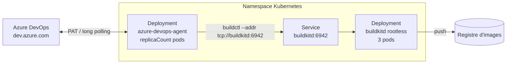

<div align="center">

# Agent Azure DevOps Septeo sur Kubernetes

**Chart Helm des agents Azure DevOps auto-hébergés de Septeo**

Maintenu par l'équipe **Intégration & Innovation** de [Septeo](https://www.septeo.com)


-success)


</div>

---

Ce chart déploie sur Kubernetes un pool d'agents Azure DevOps auto-hébergés, prêts à l'emploi, accompagnés d'un démon **BuildKit rootless** pour construire et pousser des images de conteneurs depuis les pipelines, sans Docker-in-Docker ni accès au socket Docker du nœud.

Les agents s'enregistrent automatiquement dans le pool Azure DevOps au démarrage et se désenregistrent proprement à l'arrêt : il suffit de jouer sur `replicaCount` pour monter ou descendre en charge.

## Sommaire

- [Architecture](#architecture)
- [Matrice de compatibilité](#matrice-de-compatibilité)
- [Nouveautés](#nouveautés)
- [Prérequis](#prérequis)
- [Installation](#installation)
- [Construire des images avec BuildKit](#construire-des-images-avec-buildkit)
- [Paramètres](#paramètres)
- [Sécurité](#sécurité)
- [Contenu de l'image de l'agent](#contenu-de-limage-de-lagent)
- [Publier une nouvelle version du chart](#publier-une-nouvelle-version-du-chart)
- [Équipe et crédits](#équipe-et-crédits)

## Architecture



| Ressource | Rôle |
|-----------|------|
| `Deployment` agent | Pods de l'agent Azure DevOps (image `registry.septeo.fr/septeo-ado/azure-agent`) |
| `Secret` | PAT Azure DevOps, créé uniquement si `agent.pat` est renseigné |
| `ServiceAccount` | Compte de service des agents (désactivable) |
| `Deployment` + `Service` `buildkitd` | Démon BuildKit rootless exposé sur le port `6942`, activé par défaut (`buildkit.enabled`) |

## Matrice de compatibilité

| Chart | Image de l'agent | Agent Azure DevOps | Client BuildKit |
|-------|------------------|--------------------|-----------------|
| **3.0.0** | `registry.septeo.fr/septeo-ado/azure-agent:v1.0` | **5.280.0** | **0.34.0** |
| 2.1.1 | `42069789/azure-agent:latest` | 3.248.0 | 0.19.0 |
| 2.1.0 | `42069789/azure-agent:latest` | 3.248.0 | 0.19.0 |

Les sources de l'image sont dans le dépôt [SEPTEO-OPENSOURCE/azure-devops-agent-on-kubernetes](https://github.com/SEPTEO-OPENSOURCE/azure-devops-agent-on-kubernetes).

## Nouveautés

### 3.0.0 — octobre 2026

Version majeure : nouvelle image sur le registre Septeo, agent Azure DevOps en version 5 et chart entièrement repris par l'équipe Intégration & Innovation.

> **Mise à niveau depuis 2.1.x**
>
> - L'image vient maintenant de `registry.septeo.fr`. Si le registre demande une authentification, renseigner `image.pullSecrets`.
> - `securityContext` et `podSecurityContext` étaient ignorés jusqu'ici. Si vos fichiers de valeurs les surchargent, ces surcharges s'appliquent désormais : vérifiez-les avant la mise à jour.
> - BuildKit produit maintenant des images en media types OCI par défaut (voir [Montée de version BuildKit](#montée-de-version-buildkit)).
> - Faire la mise à jour avec `-f values.yaml` plutôt que `--reuse-values`, pour profiter des nouvelles valeurs par défaut du chart.

**Nouvelle image de l'agent**, désormais hébergée sur le registre Septeo : `registry.septeo.fr/septeo-ado/azure-agent:v1.0`.

- Agent Azure DevOps mis à jour de **3.248.0 vers 5.280.0**.
- Téléchargement de l'agent depuis la nouvelle URL officielle `download.agent.dev.azure.com` (l'ancien CDN `vstsagentpackage.azureedge.net` est retiré par Microsoft).
- Client BuildKit (`buildctl`) mis à jour de **0.19.0 vers 0.34.0**.
- Ajout d'**OpenJDK 17** (JRE headless) pour les tâches Java / Maven / Gradle / SonarQube.
- Tag d'image figé (`v1.0`) au lieu de `latest`.

**Chart Helm**

- Chart estampillé Septeo : métadonnées, mainteneurs et liens pointent vers les dépôts `SEPTEO-OPENSOURCE`.
- `securityContext`, `podSecurityContext` et `buildkit.resources` sont maintenant réellement lus depuis `values.yaml` (ils étaient écrits en dur dans les templates). Les valeurs par défaut produisent exactement les mêmes manifestes qu'avant.
- `appVersion` aligné sur le tag de l'image (`v1.0`).
- BuildKit : retour au `securityContext` rootless de référence (`seccompProfile: Unconfined`, UID/GID 1000) à la place de la variante à capacités restreintes de la 2.1.1.

#### Montée de version BuildKit

Le client `buildctl` de l'image de l'agent passe de **0.19.0 (février 2025) à 0.34.0 (octobre 2026)**, soit 15 versions mineures. Le démon `buildkitd` déployé par le chart utilise l'image `moby/buildkit:master-rootless`, qui suit la branche de développement : la plupart des nouveautés côté démon listées ci-dessous sont donc déjà actives. Cette mise à jour aligne `buildctl` sur le démon et donne accès aux nouvelles options en ligne de commande.

**Changements de comportement à connaître**

- **Media types OCI par défaut pour les images** (0.31). Si un registre ou un outil n'accepte que les media types Docker, ajouter `oci-mediatypes=false` dans `--output`.
- **Attestations poussées comme artefacts OCI** (0.32) quand la provenance ou le SBOM sont activés. Ajouter `oci-artifacts=false` si le registre ne supporte pas les artefacts OCI.
- **Provenance au format SLSA v1.0 par défaut** au lieu de v0.2 (0.28), avec des déclarations in-toto v1 (0.31).
- **Cache distant** (`--export-cache type=registry`) : le manifeste de cache est un artefact OCI par défaut (0.21). `image-manifest=false` restaure l'ancien format.
- `buildctl --generate-bash-completion` est remplacé par `--generate-shell-completion` (0.31).

**Fiabilité des builds parallèles**

Nos pipelines lancent plusieurs `buildctl build` en parallèle sur les mêmes démons ; ce sont les corrections qui nous concernent le plus :

- Corrections des erreurs `snapshot does not exist` (0.29, 0.31, 0.33), `ref locked: unavailable` (0.34) et `no active session` avec un cache distant (0.33), ainsi que des échecs d'export de cache en parallèle (0.34) et des cache miss entre builds qui partagent des étapes (0.32).
- **Identifiants de registre** : correction de l'expiration des identifiants pendant les builds longs (0.20), nouvelles tentatives sur les erreurs passagères de jeton (0.34), suppression d'un interblocage quand le credential helper ne répond pas (0.30).
- Meilleure détection des pertes de connexion entre `buildctl` et le démon, qui évite les builds bloqués indéfiniment (0.30).
- **Kubernetes** : les cgroups fonctionnent sans cgroup namespace dédié (0.28), et l'initialisation des cgroups dans l'entrypoint de l'image BuildKit est corrigée (0.29).
- Récupération automatique d'une base `history.db` corrompue (0.27) et des autres bases internes illisibles (0.34), et correction de la politique de garbage collection par défaut (0.31).

**Performances**

- Le push de l'image et l'export du cache se font en parallèle (0.28), et les blobs du cache distant sont poussés en parallèle (0.27).
- Bases de données internes plus légères et plus rapides (0.32, 0.34), avec une compaction optionnelle (0.34), et moins de contention de verrous dans le solveur (0.30, 0.32).
- Nombre de connexions simultanées au registre configurable, cache distant compris (0.31, 0.33).

**Nouvelles fonctionnalités utiles**

- **Frontend Dockerfile intégré mis à jour de 1.14 à 1.28.**
- `buildctl` accepte les build-args sans valeur : la valeur est lue dans la variable d'environnement du même nom (0.33).
- **Sources Git** : option `fetch-by-commit` pour les références mouvantes comme les merges de pull request `refs/pull/<n>/merge` d'Azure Repos (0.30), dépôts SHA-256 (0.25), vérification des signatures GPG / SSH des commits (0.26).
- **Exporteurs `local` et `tar`** : option `src` pour n'exporter qu'un sous-dossier (0.34) et `mode=delete` pour remplacer le dossier de destination au lieu de fusionner (0.31).
- **Reproductibilité** : notion de « compatibility version » (0.30), et images produites en mode rootless identiques à celles du mode rootful (0.33).
- **Sécurité** : masquage d'un plus grand nombre d'identifiants dans les logs de build (0.33), images et binaires BuildKit signés (0.27).
- L'historique des builds peut être désactivé dans la configuration du démon (0.33), ce qui limite l'espace disque utilisé dans le volume `emptyDir`.

Notes de version complètes : [releases moby/buildkit](https://github.com/moby/buildkit/releases).

### 2.1.1 — mai 2026

- **Conformité Pod Security Standard `restricted`** pour l'agent : exécution non-root (UID 1000), `allowPrivilegeEscalation: false`, toutes les capabilities supprimées, `seccompProfile: RuntimeDefault`.
- Suppression des profils AppArmor (non disponible sur nos clusters).
- Requests et limits de ressources ajoutées au démon BuildKit.
- Nouvelle **readiness probe sur les keyrings** de BuildKit : un pod `buildkitd` est retiré du Service avant d'atteindre le quota de clés noyau (`/proc/key-users`, seuil 195), qui le rendrait sinon inutilisable.

### 2.1.0 — février 2025

- Première version Septeo, dérivée du chart [btungut/azure-devops-agent-on-kubernetes](https://github.com/btungut/azure-devops-agent-on-kubernetes).
- Ajout du démon **BuildKit rootless** (Deployment + Service `buildkitd:6942`) et de `buildctl` dans l'image de l'agent.
- Publication du dépôt Helm sur GitHub Pages.

## Prérequis

- Kubernetes ≥ 1.19
- Helm 3 ou plus récent
- Un **Personal Access Token (PAT)** Azure DevOps avec le scope `Agent Pools (Read & manage)` ([créer un PAT](https://learn.microsoft.com/fr-fr/azure/devops/organizations/accounts/use-personal-access-tokens-to-authenticate))
- Un pool d'agents existant dans l'organisation Azure DevOps
- Un accès en lecture à `registry.septeo.fr` depuis le cluster (via `image.pullSecrets` si le registre demande une authentification)

## Installation

### 1. Ajouter le dépôt Helm

```bash
helm repo add septeo-ado https://septeo-opensource.github.io/azure-agent-pipeline/
helm repo update
```

### 2. Stocker le PAT dans un secret (recommandé)

```bash
kubectl create secret generic azdo-pat \
  --from-literal=pat='<VOTRE-PAT>' \
  --namespace <NAMESPACE>
```

### 3. Installer le chart

```bash
helm install azdo-agent septeo-ado/azure-devops-agent \
  --namespace <NAMESPACE> \
  --set agent.organizationUrl=https://dev.azure.com/<ORGANISATION> \
  --set agent.pool="<POOL>" \
  --set agent.patSecret=azdo-pat \
  --set agent.patSecretKey=pat
```

Il est aussi possible de passer le PAT directement avec `--set agent.pat=<PAT>` : le chart crée alors le secret lui-même. Les deux options sont mutuellement exclusives.

### Exemple de `values.yaml`

```yaml
fullnameOverride: azdo-agent
replicaCount: 3

agent:
  organizationUrl: "https://dev.azure.com/<ORGANISATION>"
  pool: "kube-pprod"
  patSecret: "azdo-pat"
  patSecretKey: "pat"

image:
  pullSecrets:
    - name: registry-septeo

resources:
  requests:
    cpu: 500m
    memory: 1Gi
  limits:
    cpu: 2
    memory: 5120Mi

buildkit:
  enabled: true
```

```bash
helm upgrade --install azdo-agent septeo-ado/azure-devops-agent -n <NAMESPACE> -f values.yaml
```

### Désinstaller

```bash
helm uninstall azdo-agent -n <NAMESPACE>
```

Les agents se désenregistrent du pool Azure DevOps à l'arrêt des pods.

## Construire des images avec BuildKit

Quand `buildkit.enabled` vaut `true`, les agents joignent le démon BuildKit via le Service `buildkitd` du même namespace. Exemple d'étape de pipeline qui construit deux images en parallèle et les pousse :

```yaml
stages:
  - stage: build_and_push
    displayName: Build & push
    pool:
      name: kube-pprod
    jobs:
      - job: build
        steps:
          - checkout: self

          - task: Docker@2
            displayName: Login registre
            inputs:
              command: login
              containerRegistry: "registry-myproject"

          - script: |
              set -e

              buildctl --addr tcp://buildkitd:6942 build \
                --frontend dockerfile.v0 \
                --local context=. \
                --local dockerfile=Backend \
                --output type=image,name=registry.myproject.fr/myproject/backend:$(Build.BuildId),push=true &
              PID_BACK=$!

              buildctl --addr tcp://buildkitd:6942 build \
                --frontend dockerfile.v0 \
                --local context=. \
                --local dockerfile=Cron \
                --output type=image,name=registry.myproject.fr/myproject/cron:$(Build.BuildId),push=true &
              PID_CRON=$!

              wait $PID_BACK && wait $PID_CRON
            displayName: Build & push des images
```

La tâche `Docker@2 login` écrit les identifiants dans `~/.docker/config.json`, que `buildctl` réutilise pour pousser l'image.

> Les ressources BuildKit portent des noms fixes (`buildkitd`). Une seule release avec `buildkit.enabled: true` peut donc être installée par namespace.

## Paramètres

### Authentification de l'agent

Renseigner **soit** `agent.pat`, **soit** `agent.patSecret`.

| Paramètre | Description | Défaut |
|-----------|-------------|--------|
| `agent.pat` | PAT en clair ; le chart crée le secret | `""` |
| `agent.patSecret` | Nom d'un secret existant contenant le PAT | `""` |
| `agent.patSecretKey` | Clé du PAT dans le secret | `"pat"` |

### Configuration de l'agent

| Paramètre | Description | Défaut |
|-----------|-------------|--------|
| `agent.organizationUrl` | URL de l'organisation, par exemple `https://dev.azure.com/mon-orga` | `""` (obligatoire) |
| `agent.pool` | Pool d'agents dans lequel les agents s'enregistrent | `"Default"` |
| `agent.workingDirectory` | Répertoire de travail de l'agent | `"_work"` |
| `agent.extraEnv` | Variables d'environnement supplémentaires (dictionnaire) | `{}` |
| `replicaCount` | Nombre d'agents | `1` |

### Image

| Paramètre | Description | Défaut |
|-----------|-------------|--------|
| `image.registry` | Registre (optionnel, préfixé au dépôt) | non défini |
| `image.repository` | Dépôt de l'image de l'agent | `registry.septeo.fr/septeo-ado/azure-agent` |
| `image.tag` | Tag de l'image (`appVersion` du chart si vide) | `"v1.0"` |
| `image.pullPolicy` | Politique de pull | `Always` |
| `image.pullSecrets` | Secrets de pull | `[]` |

### Ressources et ordonnancement

| Paramètre | Description | Défaut |
|-----------|-------------|--------|
| `resources` | Requests / limits de l'agent | requests `100m` / `128Mi`, limits `2` / `5120Mi` |
| `nodeSelector` | Sélecteur de nœuds | `{}` |
| `tolerations` | Tolérances | `[]` |
| `affinity` | Affinité | `{}` |
| `volumes` / `volumeMounts` | Volumes supplémentaires pour l'agent | `[]` |
| `podLabels` / `podAnnotations` | Labels et annotations supplémentaires | `{}` |

### Sécurité

| Paramètre | Description | Défaut |
|-----------|-------------|--------|
| `podSecurityContext` | `securityContext` du pod agent | `runAsNonRoot: true` |
| `securityContext` | `securityContext` du conteneur agent | Profil `restricted` (voir [Sécurité](#sécurité)) |
| `serviceAccount.create` | Créer un ServiceAccount dédié | `true` |
| `serviceAccount.name` | Nom du ServiceAccount (généré si vide) | `""` |
| `serviceAccount.automount` | Monter le token du ServiceAccount | `true` |
| `serviceAccount.annotations` | Annotations du ServiceAccount | `{}` |

### BuildKit

| Paramètre | Description | Défaut |
|-----------|-------------|--------|
| `buildkit.enabled` | Déployer le démon BuildKit rootless et son Service | `true` |
| `buildkit.resources` | Requests / limits de chaque pod `buildkitd` | requests `100m` / `128Mi`, limits `2` / `5120Mi` |

## Sécurité

**Agent** : conforme au Pod Security Standard `restricted`.

```yaml
podSecurityContext:
  runAsNonRoot: true
securityContext:
  allowPrivilegeEscalation: false
  runAsNonRoot: true
  runAsUser: 1000
  capabilities:
    drop: [ALL]
  seccompProfile:
    type: RuntimeDefault
```

**BuildKit** : le mode rootless de BuildKit a besoin de `seccompProfile: Unconfined` pour créer ses user namespaces (voir la [documentation rootless de BuildKit](https://github.com/moby/buildkit/blob/master/docs/rootless.md)). Il tourne en UID/GID 1000, sans être privilégié, mais le namespace qui l'héberge ne peut pas imposer le niveau `restricted` ni `baseline`. Si le namespace applique Pod Security Admission, il faut soit le passer en `privileged`, soit installer les agents avec `buildkit.enabled: false`.

## Contenu de l'image de l'agent

Image `registry.septeo.fr/septeo-ado/azure-agent:v1.0`, construite depuis [SEPTEO-OPENSOURCE/azure-devops-agent-on-kubernetes](https://github.com/SEPTEO-OPENSOURCE/azure-devops-agent-on-kubernetes) :

- Ubuntu 20.04, utilisateur non-root `azdouser` (UID 1000)
- Agent Azure DevOps 5.280.0
- BuildKit `buildctl` 0.34.0
- OpenJDK 17 (JRE headless)
- Azure CLI avec l'extension Azure DevOps
- kubectl, Helm 3, yq, jq
- PowerShell Core
- Docker CLI
- git, curl, wget, unzip, vim

## Publier une nouvelle version du chart

Le dépôt Helm est servi par GitHub Pages depuis le dossier `docs/`.

```bash
# 1. Incrémenter "version" dans chart/Chart.yaml (et "appVersion" si l'image change)
# 2. Packager le chart dans docs/
helm lint chart --set agent.pat=x --set agent.organizationUrl=https://dev.azure.com/x
helm package chart -d docs/

# 3. Mettre à jour l'index en conservant les versions existantes
helm repo index docs/ \
  --url https://septeo-opensource.github.io/azure-agent-pipeline/ \
  --merge docs/index.yaml

# 4. Committer docs/ et chart/, puis pousser sur main
```

## Équipe et crédits

Chart et image maintenus par l'équipe **Intégration & Innovation** de **Septeo**.

| Contact | |
|---------|--|
| Dylan Caudoux | dylan.caudoux@septeo.com |
| Jonathan Diouf | jonathan.diouf@septeo.com |

Ce projet est dérivé de [btungut/azure-devops-agent-on-kubernetes](https://github.com/btungut/azure-devops-agent-on-kubernetes) de Burak Tungut, distribué sous licence MIT.
